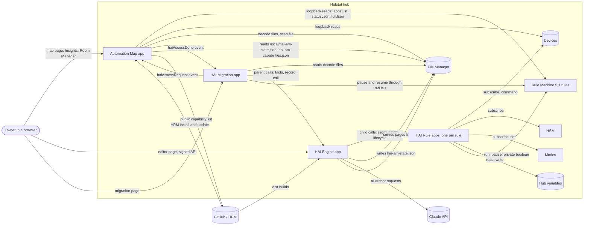
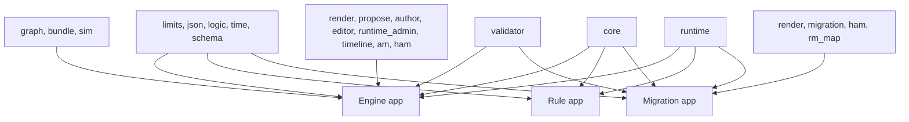
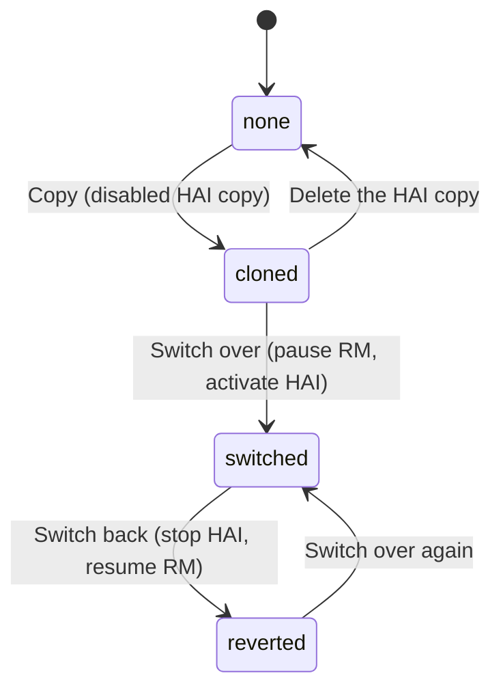
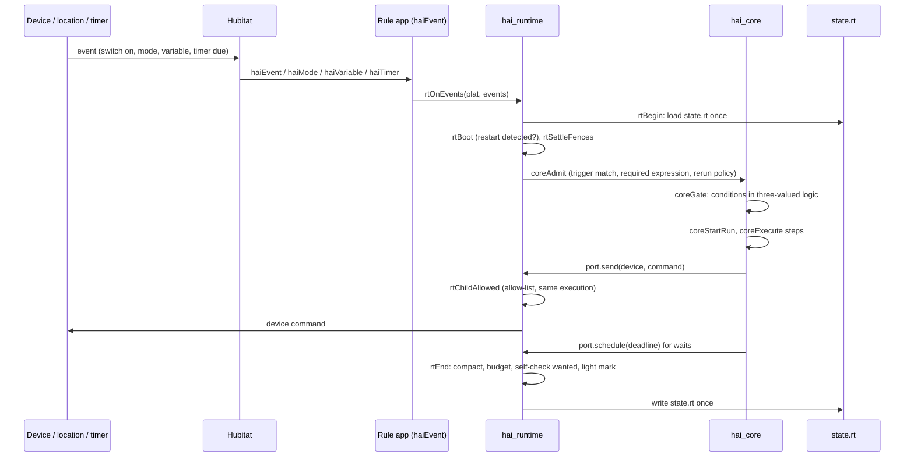
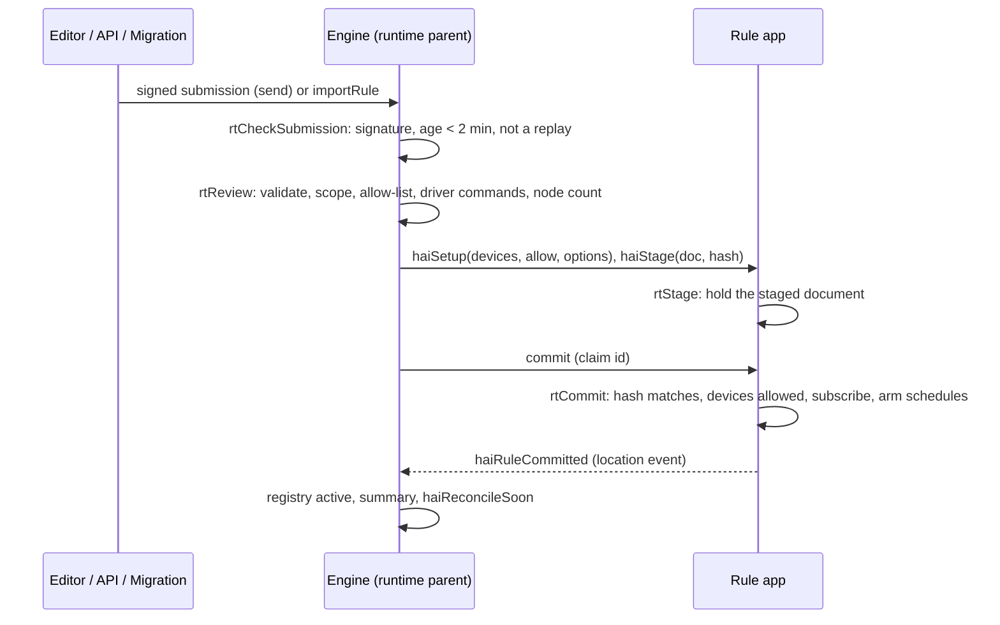
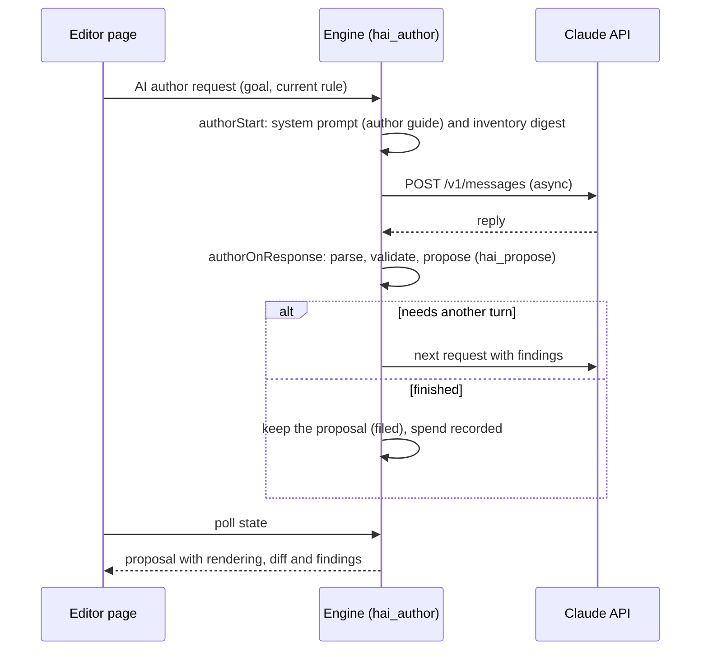
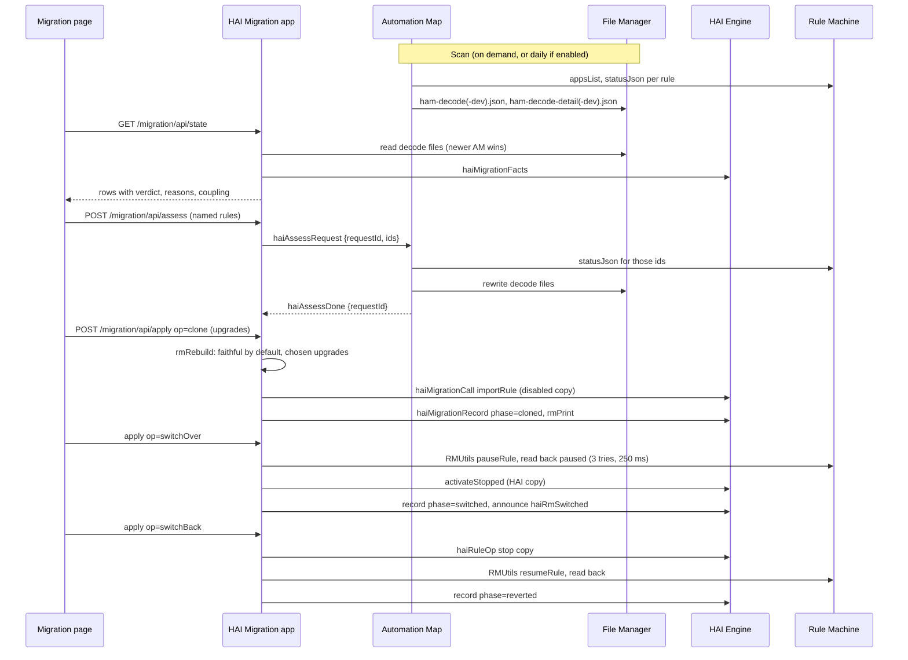

# HAI ecosystem: current-state architecture

Applies to HAI Engine version 0.5.87.

This document describes how Automation Map, the HAI Engine and HAI Migration are built and run, for an
engineer, tester or security reviewer. It describes the code. The source constants are the authority where
this text and the code differ.

A one-page diagram of the components, the hub boundary and the main flows is in
[architecture-map.html](architecture-map.html), maintained with this document.

Contents:

1. Purpose, scope and versions
2. Context
3. Components
4. Data and contracts
5. Runtime internals
6. Editor and AI author
7. Migration pipeline
8. Automation Map internals
9. Endpoints
10. Hub cost model
11. Security model
12. Delivery and checks
13. Known gaps and risks

---

## 1. Purpose, scope and versions

The ecosystem gives a Hubitat Elevation hub owner three things:

| Product | What it is for | Who uses it | Repository |
|---|---|---|---|
| **Automation Map** | Scans the hub and shows every device, app and rule as one interactive map, with Insights, a Room Manager and decoded rule flows. It also publishes what it decoded, so HAI can read Rule Machine rules without parsing them itself. | Any Hubitat owner. Installed through Hubitat Package Manager. | `hubitat-automation-map` (public) |
| **HAI Engine** | A rule engine with its own rule format (`hai.rule/1`), a browser editor, an AI author, and a runtime: one small app per rule, a registry and a watchdog. Built as a replacement for Rule Machine, at parity with Rule Machine 5.1. | The owner writing and running automations; other apps and AI clients through its endpoints. | `hubitat-automation-intelligence` |
| **HAI Migration** | Moves Rule Machine rules to HAI one at a time. Both sides are kept until the owner trusts the copy: assess, copy, switch over, watch, switch back. | The owner migrating from Rule Machine. | Same HAI repository. An optional child app of the Engine. |

Out of scope here: the MCP Rule Server, a third-party app on the hub that external tools call over its own
`/mcp` to drive Rule Machine (see `docs/mcp-rule-server.md`); the evaluation tooling under `engine/eval`;
and the milestone prototypes (`engine/m4`, `engine/m5/hai_runtime_spike_*`), which are not deployed.

### Versions

The source constants are the authority: `ENGINE_APP_VERSION` in `engine/app/hai_engine_app.groovy`,
`APP_VERSION` and `GRAPH_SCHEMA` in Automation Map's `apps/automation_map.groovy`, and `MIGRATION_CONTRACT`
in both HAI apps. The compatibility facts that matter between the parts:

| Seam | Version |
|---|---|
| Decode contract (Automation Map to HAI) | `contractSchemaVersion` 4 (HAI also reads 1 to 3), `rmConstructVocabularyVersion` 2 |
| Engine to Migration | `MIGRATION_CONTRACT` 2. The Engine and Migration must agree; Migration refuses to act on a mismatch. |
| Automation Map feed | `hai.am/1` |
| Rule format | `hai.rule/1` (engine generation HAI-1) |
| Rule Machine parity | 140 of 140 Rule Machine 5.1 capabilities implemented and hub-tested; 31 HAI-only capabilities, all hub-tested |

---

## 2. Context



Two facts shape everything else:

- **The hub is small.** Every app shares one JVM and a limited Metaspace. An app's whole `state` is loaded
  on every execution, and every code save costs memory until the hub restarts. Much of the design (shrunk
  builds, pages in File Manager, light marks, quiet watchdog answers) exists to stay inside that.
- **Apps on one hub cannot call each other safely**, except a parent calling its own children. Two
  single-threaded apps calling each other can deadlock. So the Engine calls its children directly, and
  everything else travels as location events, which Hubitat delivers after the sender's execution ends.

---

## 3. Components

### 3.1 Automation Map

| Piece | What | Served how |
|---|---|---|
| `apps/automation_map.groovy` | The whole app, about 1.5 MB of Groovy: scan pipeline, decoders, graph build, settings pages, the map page (HTML, CSS and JavaScript held as strings), Room Manager, decode writers, the HAI feed reader. | Hubitat app with OAuth. The map is a full HTML page returned from `/automation-map.html`. |
| Drawing libraries | vis-network from unpkg (with SRI), and Mermaid from jsDelivr, loaded lazily for flow diagrams. | The browser loads them from the CDN. |
| `packageManifest.json` | The Hubitat Package Manager package. Its `version` and `apps[0].version` rise with `APP_VERSION`. | Raw GitHub URL. |
| `public/hai-capabilities.json` | The public HAI capability list Automation Map reads to draw Table 1 when the hub has no HAI Engine. | Raw GitHub, pinned by `FEED_LOCK.json`. |
| `tests/` | Groovy and JavaScript suites that slice real functions out of the app, and decode fixtures with invented names. | CI on Groovy 2.4. |

There are no child apps and no libraries: Automation Map is deliberately one file.

### 3.2 HAI Engine

Three hub apps, each assembled from one entry file plus libraries:

| App | Entry | Role | Built size (`dist/`) |
|---|---|---|---|
| **HAI Engine (Preview)** | `engine/app/hai_engine_app.groovy` | Parent. Settings page with the device picker (Approved devices), the editor and its signed API, the AI author, the MCP server, the rule endpoints, the Automation Map feed, and the runtime parent: registry, activation review, staging, the watchdog, the summary, rule backups. | about 720 KB |
| **HAI Rule Container (Preview)** | `engine/m5/hai_rule_app.groovy` | One child per rule. Holds the rule's state, subscribes to what it needs, runs it. Compiled once and shared by every rule. | about 265 KB |
| **HAI Migration (Preview)** | `engine/app/hai_migration_app.groovy` | Optional child of the Engine. Migration page and its API, decode reader, converter, migration steps. | about 220 KB |

Pages are not in the Groovy. The editor (`engine/app/editor/editor.html`, about 850 KB), its fixed tables
(`specs.json`, uploaded as `hai-editor-specs.json`), the AI guide (`hai-author-guide.txt`) and the migration
page (`engine/app/migration/migration.html`, uploaded as `hai-migration.html`) live in File Manager. Each app
embeds the SHA-256 of the page it was built with (`//#sha256` directives filled in by `assemble.py`) and
refuses to serve a file whose hash differs. `engine/upload-editor-page.ps1` uploads them.

#### Libraries (`engine/lib/`)

One line per file, on its responsibility. Sizes are source lines.

| Library | Lines | Responsibility |
|---|---|---|
| `hai_limits` | 106 | Finite bounds (sizes, depths, counts) enforced before any input is processed. |
| `hai_json` | 398 | Strict JSON reader and canonical writer for rule documents. No custom classes (the sandbox forbids them). |
| `hai_logic` | 186 | Three-valued logic: true, false, unknown. Unknown is never false. |
| `hai_time` | 303 | Wall-clock occurrences and windows, including daylight saving gaps and repeats. |
| `hai_schema` | 771 | The `hai.rule/1` shape, its defaults (part of canonical form) and the operation catalogue. |
| `hai_validator` | 2001 | Five validation classes: schema, references, structure, behaviour warnings, safety. Every finding names a reason and a path. |
| `hai_graph` | 469 | Dependency graph, effect index and rule-call cycle detection. |
| `hai_bundle` | 401 | Export and import of the portable definition, kept apart from hub identity and runtime state. |
| `hai_core` | 3946 | The rule semantics, once: admission, gating, the run lifecycle, steps, waits, restart recovery, dispatch checks, confirmation ladder, durations, schedules. |
| `hai_sim` | 843 | The simulator: a port for the core with a virtual clock and a scripted command model. No device capability at all. |
| `hai_runtime` | 2889 | The hub adapter for one rule child: state encoding, timers as deadlines, subscriptions, sends, light marks, watchdog answers. |
| `hai_runtime_admin` | 2630 | The runtime parent: registry, activation review, candidates, staging, allow-list, reconcile, watchdog, endpoint and app-API operations. |
| `hai_render` | 731 | Deterministic plain-English rendering of a rule and a structural diff. A model never writes what a person approves. |
| `hai_propose` | 758 | Evaluates a candidate and returns evidence. It cannot activate or command. Same path for a person, a model or an MCP client. |
| `hai_author` | 1119 | The AI authoring loop as a state machine (request out, reply in), model `claude-opus-5`, spend accounting. |
| `hai_editor` | 1967 | Server side of the editor: field specs, sentences, validation, simulation, bounded drafts. |
| `hai_timeline` | 450 | "Why did this run" and "why did it not run" from a rule's retained trace. |
| `hai_am` | 390 | The Automation Map feed (`hai.am/1`): every HAI rule as nodes, edges and flows, from the registry alone. |
| `hai_ham` | 436 | Consumer side of the decode contract. The only HAI code that knows Automation Map exists. |
| `hai_rm_map` | 3769 | Rule Machine constructs to HAI: `rmRebuild` and the named refusals. |
| `hai_migration` | 1406 | Migration steps: pairing, clone, switch over, switch back, delete copy, watch, the ledger. |
| `hai_m4` | 173 | M4 layout prototypes only. Not deployed. |

Which libraries go into which app (`engine/make-dist.py`, mirrored in `deploy-hub.ps1` and checked to agree):



The Rule app does not carry the validator. Rules are validated in the Engine's activation review
(`rtReview`), and a rule app commits only the staged document whose hash the Engine stamped.

#### Build

- `engine/assemble.py --shrink` joins entry and libraries and shrinks them. It removes methods and constants
  nothing refers to, comments, blank lines, indentation, `private`, alignment spaces and some casts.
- `engine/make-dist.py` writes the three shrunk apps into `dist/`, which Hubitat Package Manager points at.
  `--check` fails if `dist/` is stale.
- `engine/compile_check.groovy` compiles each shrunk build on Groovy 2.4 (the hub's version) before deploy.
  Newer Groovy accepts shapes the hub refuses.
- `engine/deploy-hub.ps1` is the reviewed deployment: backup, optimistic lock, size check, read-back and
  hash check. It reads free hub memory before and after a deploy.
- Versions: `ENGINE_APP_VERSION` in the Engine; `EXPECTED_ENGINE_CONTRACT` in Migration matches
  `MIGRATION_CONTRACT` in the Engine.

### 3.3 HAI Migration

The Migration app is a child of the Engine, so a hub that does not migrate carries none of it. It owns the
migration page (`/migration`), the decode reader (`hai_ham`), the converter (`hai_rm_map`) and the steps
(`hai_migration`). It asks the Engine for what only the Engine holds through three parent calls
(`haiMigrationFacts`, `haiMigrationRecord`, `haiMigrationCall`, section 4.4). The Engine never calls it.

---

## 4. Data and contracts

### 4.1 The rule document, `hai.rule/1`

A rule is one JSON document. The full reference is [rule-format.md](developer/rule-format.md). The shape
and defaults are code in `hai_schema.groovy`. Canonical form omits members equal to their default, so a
default change is a schema change; it is specified in `engine/spec/canonicalisation.md`.

```json
{
  "schema": "hai.rule/1",
  "id": "hall-light-at-night",
  "name": "Hall Light at night",
  "refs": {
    "hall":   {"kind": "device", "id": "dev:101", "name": "Hall Light", "capabilities": ["Switch"]},
    "motion": {"kind": "device", "id": "dev:102", "name": "Hall Motion", "capabilities": ["MotionSensor"]},
    "night":  {"kind": "mode", "name": "Night"}
  },
  "triggers":   [{"kind": "deviceAttribute", "ref": "motion", "attribute": "motion", "value": "active"}],
  "conditions": {"type": "mode", "ref": "night"},
  "actions":    [{"type": "command", "ref": "hall", "command": "on"},
                 {"type": "wait", "seconds": 120},
                 {"type": "command", "ref": "hall", "command": "off"}]
}
```

| Part | Contents |
|---|---|
| `refs` | Every device, variable (hub `hv:<name>` or rule `rv:<key>`), mode, room, HAI rule, Rule Machine rule (`rmRule`), `self` and `eventDevice` the rule uses, by key. A device carries its capabilities so an import can find a match on another hub. |
| `triggers` | Any one starts the rule: device attribute (transition or every event, physical or digital), threshold, duration ("and stays"), button, schedule (time, sun, variable, days, dates), periodic (Quartz cron), mode, hub variable, rule invocation, rule paused, HSM status and alert, location events, endpoint. Each may carry its own `condition`. |
| `conditions` | The "only if" tree: `all`, `any`, `not`, `xor`, `count`, and leaves (device attribute with `freshSeconds`, variable, mode, time window, day of week, date range, time since, triggered by, rule paused, HSM status, wait outcome). |
| `actions` | The steps in order: commands, if/else-if/else, waits (time, event, condition, with timeouts), repeats, variables, modes, notifications, HTTP, rule control, capture and restore, gradual level, logs and others. |
| Settings | `rerunPolicy` (`restart` default, `ignore`, `queue`, `parallel`, with limits), `onUnknown` (`block` default, `proceed`), `ifUnknown` (`stop` default, `otherwise`), `errorPolicy` (`stopRun` default, `continue`, `failurePath` with `onFailure`), `onCancel`, `enabled`, `initialEvaluation`, `conditionTiming` (`atTrigger`, `atRunStart`), `requiredExpression` with `cancelOnFalse`, `pauseMode` (`finish`, `hold`), and Rule Machine's three logging switches. |

Every rule has a Private Boolean, the rule variable `rv:privateBoolean`, starting true.

### 4.2 Automation Map decode files

Automation Map writes two files to File Manager at the end of each scan and after each Assess now request.
The HAI Engine and Migration read them with `downloadHubFile`, with no token. Automation Map reads HAI's
files the other way, over loopback (`/local/<file>`).

| File | Contract | Contents |
|---|---|---|
| `ham-decode.json` (production channel) / `ham-decode-dev.json` (Dev channel) | `ham.decode/1` (summary) | Per rule: id, name, engine, status, `hasDecodedFlow`, the construct tokens used. Scan facts: `lastScanCompletedAt`, `staleAfterSeconds`, auto-scan setting. |
| `ham-decode-detail.json` / `ham-decode-detail-dev.json` | `ham.decode.detail/1` (detail) | Per rule: triggers, conditions, expressions, actions, steps, labels with operands, `supported`, `decodeFailures`; hub variable types. The input to `rmRebuild`. |

Every file carries one envelope (`hamDecodeEnvelope`):

| Field | Meaning |
|---|---|
| `contract` | `ham.decode/1` or `ham.decode.detail/1`. The names differ so one cannot be read as the other. |
| `contractSchemaVersion` | 4. HAI refuses a schema it does not list (`HAM_SCHEMAS` in `hai_ham`: 1 to 4). |
| `rmConstructVocabularyVersion` | 2. Raised whenever the decoder vocabulary changes, so a stale file is detectable. |
| `supportedEngine` | `Rule-5.1`. |
| `instance` | `appId`, `appName`, `appVersion`, `buildChannel`. A consumer refuses a cross-channel file. |
| `generatedAt` | When this document was built (Automation Map 2.4.36 and later). Moves on a targeted rescan, where `lastScanCompletedAt` does not. |
| `ok`, `issue`, `message` | Fails closed: either ok with a payload, or not ok with a fixed issue code (for example `no-scan`). There is no partial form. |

Rule status uses one vocabulary with the published app list, in this precedence: `deleted-but-referenced`,
`unreadable`, `disabled`, `paused`, `unscanned`, `inert`, `active`.

When both production and Dev files exist, Migration uses the one written by the newer Automation Map
(`instance.appVersion` compared segment by segment). When only one exists, it uses that one.

### 4.3 Assess now (request and answer events)

Migration asks Automation Map for a fresh decode without a full scan. Both are location events between two
apps on the same hub, so there is no token.

| Event | From, to | Value (JSON) |
|---|---|---|
| `haiAssessRequest` | Migration to Automation Map | `{requestId, appId, ids: [rule app ids]}` or `{requestId, appId, all: true}`. `appId` names one Automation Map instance; another channel ignores it. |
| `haiAssessDone` | Automation Map to Migration | `{requestId, ...}` once the decode files are rewritten, or `busy`. |

On the Automation Map side (`ensureHaiAssessSubscription`, `haiAssessRequestHandler`): one subscription
row; one targeted rescan at a time (`HAI_ASSESS_RUNNING`); duplicates dropped (`HAI_ASSESS_SEEN`). A request
for named ids does one statusJson read per id, one device-facts read, one graph build, one published-file
commit and one write of each decode file. A request above 40 percent of the hub's Rule Machine rules
(`HAI_ASSESS_FULL_SCAN_SHARE`), or `all: true`, starts the ordinary full scan, which answers when it
publishes.

### 4.4 The migration ledger

The ledger lives in the **Engine's** state as `state.migPairs`, keyed by Rule Machine rule id. The Engine
must know about switched pairs to retarget other rules (section 5.10). Migration reads and writes it only
through the seam:

| Call | Purpose |
|---|---|
| `haiMigrationFacts(pairsOnly)` | HAI's rules, the ledger, the Rule Machine paused cache, the device permissions and the contract version. `pairsOnly` returns just the ledger for a step that records. |
| `haiMigrationRecord(pairs, rmId, rmPaused)` | Writes the ledger (and announces the switched map) and records a known paused state. |
| `haiMigrationCall(name, arg)` | Ops: `haiRuleOp`, `activateStopped`, `rmPausedNow`, `importRule`, `dryRun`. |

A pair row holds `phase`, `haiId`, `rmPrint` (a fingerprint of the decoded Rule Machine rule at copy time,
for "changed since copied"), the chosen upgrades and the last result. Phases (`MIG_PHASES`):



Which side is live is read from the two live states, not inferred from the phase: `rm`, `hai`, `both` or
`neither`. Deletes are separate deliberate acts; nothing deletes automatically.

### 4.5 Runtime registry, summary and light marks

| Item | Where | What |
|---|---|---|
| Registry | Engine `state` (`rtRegistry`) | One entry per rule: `ruleId`, `childId`, `state` (`staging`, `active`, `disabled`, `removed`), `epoch`, `ruleHash`, the active document, version history. Tombstones are pruned above a cap. Only the activation path and reconcile write it; the watchdog reads it. |
| Candidates and claims | Engine `state` | Bounded store of submitted candidates (`open`, `claimed`, `consumed`, `expired`) and single-use activation claims with nonces. |
| Rule state | Each rule app's `state.rt` | The rule's world: run records, ledger, deadlines, trace, health, variables, Private Boolean, subscriptions, staged document, `rmSwitched`, `lightMark`, `allowHash`. Written once per execution (`rtEnd`), under a byte budget. |
| Light mark | Returned by each rule app | `rtLight`: rule id, epoch, hash, paused, disabled, staged, and a `mark` string that moves whenever anything a person would see changed (epoch, run counter, last run and its length, last rejection and note, ledger size, blocked). The Engine reads a rule in full only when its mark moved. |
| Summary | Engine `state.runtimeSummary`, and the `haiRuntimeSummary` location event | Each rule's name, state, version and recent runs; the last request's result; which hub variables rules may change. One copy is kept in state. The event is for listeners, because an app does not receive its own location events. |
| Rule Machine paused cache | Engine `state.runtimeRmPaused` | Paused state of the Rule Machine rules that HAI rules or the ledger refer to. Read from one app-list read per watchdog pass. |
| Rule backups | Engine `state` (index) and File Manager (`hai-backup-<yyyyMMdd>.json`) | A daily backup of every live rule's document, written only on a day a rule changed. The last ten are kept. |

### 4.6 The editor drafts store

Drafts are kept apart from what the hub runs. A draft is a document the person is editing; the hub version
is the registry's active document. The editor's line above the rule says which one is open. Limits
(`hai_editor`): 64 KB per draft, 384 KB for all drafts.

The drafts and the AI author's working data are **filed**, not kept in state (`ENGINE_FILED`):
`editorDrafts`, `proposals`, `proposalRules`, `engineSession`, `engineOutcome`, `engineAmendment`, each in
`hai-engine-<app id>-<name>.json`. A file is read once and kept in memory as text (`ENGINE_FILED_TEXT`). An
old state copy is moved by a scheduled `haiFiledMove`, never inline. A concurrent long execution writing
back its loaded state could otherwise undo an inline move.

### 4.7 State versus File Manager

An app's request costs about what loading its whole `state` costs. So anything large and read by few paths
goes to a file.

| Owner | In `state` (or `atomicState`) | In File Manager |
|---|---|---|
| Automation Map | Settings, scan progress and locks, pointers, app count, `haiAssessSubscribed` (atomic) | `automation-map-<id>-scan.json` (graph and app list), pending app results, the four decode files |
| HAI Engine | Registry, candidates, summary, ledger (`migPairs`), audience and signing keys, receipt key, API token, replay list, watchdog record, paused cache, backup index | Editor page, specs, author guide; drafts and AI data (`hai-engine-<id>-*.json`); rule backups; `hai-am-capabilities.json` and `hai-am-state.json`, which Automation Map reads |
| HAI Rule app | `state.rt` (the rule's whole world, budgeted) | Nothing |
| HAI Migration | `assess` results, `assessAm`, `migStep` (in-progress step), `planApproved` | Migration page; reads the decode files |

---

## 5. Runtime internals

### 5.1 One semantics, two adapters

`hai_core` holds the rule semantics once. Two thin adapters give it a **port** (a map of closures):

- `hai_sim` (the simulator): virtual clock, supplied state, commands appended to a list.
- `hai_runtime` (the hub, inside each Rule app): the hub clock, subscriptions, timers as absolute deadlines,
  device reads and sends, hub variables, location events for rule-to-rule calls, HTTP, files.

Conformance tests replay the simulator's golden scenarios through the hub adapter and require the same
commands, outcomes and confirmations. A simulator result alone never counts as hub-tested (section 12.3).

### 5.2 An event reaching a rule



### 5.3 rtExecute, rtBegin and rtEnd

Every entry into a rule app (an event, a timer, a parent call) is one **execution** wrapped in
`rtExecute(plat, work)`:

- `rtBegin` loads `state.rt` once, decodes the world, builds the port, runs `rtBoot` (restart detection)
  and `rtSettleFences` (sends left in flight by an execution that ended badly).
- `work(ctx)` does the job.
- `rtEnd` flushes loose trace entries, compacts the trace and ledger (`rtCompact`), applies the byte
  budget (`rtBudget`, measured only when state grew), decides whether the self-check is wanted
  (`rtSelfCheckWanted`), saves the light mark, and writes `state.rt` **once**.

A throw leaves state as it was, as on the hub. One write per execution is the main reason the rule app is
cheap.

### 5.4 Admission

`coreAdmit` decides whether an event becomes a run:

1. The trigger matches (`coreTriggerMatches`): attribute, value or comparison, transition versus every
   event, physical versus digital, button number and action, schedule token, and the trigger's own
   condition read just after the event.
2. The required expression, judged as it stood just before the event. With `cancelOnFalse`, runs under
   way are cancelled when it turns false, checked after every event and before every step.
3. The rerun policy when a run is already going: `restart` cancels it, `ignore` drops the new one, `queue`
   holds up to `queueLimit`, `parallel` allows up to `parallelLimit`.
4. A paused rule admits nothing. With `pauseMode: hold`, its running runs wait where they are.

Admission is bounded: at most 1024 evaluations per event (`RT_MAX_EVALS_PER_EVENT`).

### 5.5 Conditions and unknown handling

Logic is three-valued (`hai_logic`). A reading is **unknown** when the device has none, it is older than
`freshSeconds`, a variable is unset, or a comparison reads a non-number. Unknown is never false, unless a
leaf says `unknownAs: false`.

| Where | Setting | Default | Unknown means |
|---|---|---|---|
| The rule's `conditions` | `onUnknown` | `block` | The run does not start (logged with the reason). `proceed` treats it as true. |
| An `if` inside the steps | `ifUnknown` | `stop` | The run fails with `DECISION_UNKNOWN` and takes no branch. `otherwise` takes the ELSE (or the next ELSE-IF), as Rule Machine does; the trace says a reading was missing. |
| A step failing | `errorPolicy` | `stopRun` | `continue` goes on; `failurePath` runs `onFailure`. This also decides what follows a `DECISION_UNKNOWN` stop. |

Copies made by Migration set `ifUnknown: otherwise` and `unknownAs: false` on the conditions they build,
so they behave as the Rule Machine original. The migration page offers the per-rule choice.
`conditionTiming` decides whether conditions are read when the trigger is admitted or when a queued run
starts.

### 5.6 Steps and the confirmation ladder

Steps run in order inside `coreExecute`. A device command passes three gates and a ladder:

1. **Allow-list**: the device must be on the Engine's Approved devices, checked again just before sending
   in the same execution (`rtChildAllowed`).
2. **Driver**: the command must be one the driver offers (`rtDriverCommand`).
3. **Fences**: a send is fenced in `atomicState`, so an execution that dies mid-send is settled next time.
4. **Ladder**: `requested`, `dispatched`, then confirmed by the device's report or a read of its state. A
   command whose effect cannot be observed is recorded as unknown and never retried on that basis.

Other steps (variables, modes, HTTP, notifications, files, capture and restore, gradual level, repeats)
go through the same port, so the simulator and the hub share their rules.

### 5.7 Timers and deadlines

Every wait, delay, "and stays" interval, repeat and schedule is a row in `rt.deadlines` with an absolute
`dueAt` and a token. The hub job (`runOnce` at `dueAt` to `haiTimer` with the token, through the port's
`timerAt`) is only a wake-up. `runInMillis` serves only continuations (`haiContinue`) and commits
(`haiCommit`). A duplicate or stale job is dropped by its token, and orphaned jobs are cleaned up by
`rtRebuildTimerJobs`. Schedules re-arm their next occurrence after firing (`coreArmNextOccurrence`). Sun
times and variable times are re-read when they change.

### 5.8 The self-check, the watchdog and the quiet path

Two mechanisms catch a deadline the hub failed to deliver:

- **The self-check** (in each rule app). It is **one shot per deadline**: `runOnce` of `haiSelfCheck` at
  the earliest unfired `dueAt` (never sooner than a second away), re-armed after a restart. A rule with
  nothing pending schedules nothing.
- **The watchdog** (in the Engine, `haiWatchdog` on cron `17 7/15 * * * ?`, every 15 minutes). For each
  active or staging rule it calls the child's `haiOverdue`, which fires anything past its 30-second grace,
  reports late samples and health (`STATE_BUDGET`, `TIMER_RECOVERY_EXCEEDED`, a recovery over 2 minutes)
  and returns the light mark. A pass has a time budget. Slow children are deferred to the next pass and
  asked first then.

**The quiet path** (`rtWatchdogCall` and `rtOverdueQuiet`): a rule with nothing for the watchdog answers
from the state already loaded for the call and **writes nothing**. It is quiet only if all of these hold:

- the Engine's allow-list hash is the one the rule last applied;
- the build, active version and subscriptions match the last full pass (`watchKey`);
- no unfired deadline is past its grace, and every schedule holds its next deadline;
- no late samples wait;
- the rule is not blocked, staged or stopped;
- the hub has not restarted since the rule last ran.

Anything else is the full pass. The summary still learns of every run, because each execution saves its
light mark and the quiet answer hands it over.

### 5.9 Restart recovery

`rtBoot` compares the hub's uptime with the last time the rule ran. After a restart (`rtOnRestart`):

- the restart epoch rises;
- "and stays" durations are dropped (their evidence is gone);
- subscriptions are renewed;
- future deadlines are armed again, and past ones fire once now, in due order;
- schedules are ensured.

A waiting run applies its wait's `onRestart` policy: `reevaluate` (default), `catchUp` or `skip`.

### 5.10 Private Boolean, rule-to-rule control and switch-over retargeting

- **Private Boolean** is a rule variable (`rv:privateBoolean`). `setRuleBoolean` on another HAI rule or on a
  Rule Machine rule sets it. A change can trigger the rule through a `hubVariable` trigger on it.
- **Rule-to-rule calls** use location events, never direct calls (deadlock). `haiRuleInvoke` runs another
  rule (`runRule`, `runActions`), carrying the caller, run and depth. The target checks the name is its own
  and the depth is at most 8 (`CORE_MAX_CALL_DEPTH`). `haiRuleReturn` answers a caller that waits.
  `haiRuleControl` pauses, resumes, cancels timers or sets the Private Boolean. `haiRulePaused` announces a
  HAI rule's pause for `rulePaused` triggers. A Rule Machine rule is driven through `RMUtils`, and its
  paused state comes from the Engine's cache.
- **Switch-over retargeting.** When a Rule Machine rule is switched over, the Engine announces the switched
  map (`haiRmSwitched`, from `migPairs`). Only rules that act on a Rule Machine rule listen
  (`rtOnSwitched`). Each keeps the part it uses in `rt.rmSwitched`. From then on its Private Boolean, run,
  pause and cancel steps aimed at the Rule Machine rule go to the HAI copy instead. Disable and enable stay
  with the Rule Machine app. Switch back removes the entry, and the steps go to Rule Machine again.

### 5.11 Activation: from candidate to running



Put on hub is the decision; nothing asks a second time. A staged rule whose commit is not confirmed is
reconciled 15 seconds later (`haiReconcileSoon`), and expired staging is released.

---

## 6. Editor and AI author

### 6.1 Page architecture

The editor is a single-page application in one HTML file, served by the Engine at `/editor` from File
Manager after a hash check. On open it fetches:

- `/editor/api/fixed`: the field specs, labels, templates and command list (`hai-editor-specs.json`),
  fixed for a build and cached by the browser;
- `/editor/api/state`: the device inventory, modes, hub variables, Rule Machine rules, the runtime summary,
  drafts and limits.

Forms are generated from the field specs. Every block shows the hub's own sentence (`hai_render`), so what
a person reads is generated from the document, never from a model. Starter patterns are grouped, with a
search box. `engine/app/editor/contract.js` is a browser contract test run in CI against a preview of the
page.

### 6.2 The signed API

| Action | Route | What happens |
|---|---|---|
| Check | `POST /editor/api/check` | Validates, simulates, renders and lists what activation would need. Returns findings and a **receipt**: an HMAC with the Engine's receipt key (`haiReceiptKey`, never sent anywhere) over the checked document and inventory. |
| Save draft | `POST /editor/api/draft`, `/save` | Stores a draft in the filed store. |
| Put on hub | `POST /editor/api/send` | With a valid receipt for the same document, skips re-checking. Signs the rule with `haiSigningKey` and hands it to the runtime in the same request (`runtimeSubmitBody`). |
| Run now | The editor's run button; `/endpoint/rules/:id/run` for other callers | Runs the rule's actions as Rule Machine's Run Actions does. |
| Run one step | `POST /editor/api/run-step` | Runs a single step on the hub, for testing a command. |
| Rule, runtime | `GET /editor/api/rule`, `/runtime`, `/active` | The hub version, the run timeline (`hai_timeline`), the active list. |
| Export, import | `POST /editor/api/export`, `/import` | Portable bundle (`hai_bundle`). |
| Backups | `GET /editor/api/backups`, `GET` and `POST /editor/api/backup` | List, read and make rule backups. |

A receipt is not a cache of Check by document hash. The same rule can get a different answer as device
states change, so each Check is run fresh.

### 6.3 Live values

The page opens the hub's own event socket (`ws://<hub>/eventsocket`, `wss://` over https), the one the
hub's device pages use, and updates values shown beside the rule. No HAI code runs per device event for
this. `/editor/api/device` reads up to 20 named devices on demand.

### 6.4 Drafts versus hub version

The draft and the hub version are kept apart. Opening a rule shows the hub version unless a draft exists;
the line above the rule says which is open. Putting a draft on the hub makes it the hub version. Until
then, no edit touches the running rule.

### 6.5 The AI author



The loop is a state machine (`authorStart`, `authorOnResponse`), so tests drive it with scripted replies.
The model is `claude-opus-5` at `https://api.anthropic.com/v1/messages`, with the key in the Engine's
settings. Spend is tracked per draft. An AI-written rule is always a draft: it reaches the hub only when a
person presses Put on hub, through the same Check and activation review as any rule. The MCP server
(`/mcp`) gives an external AI client the same draft and check powers and no write power.

---

## 7. Migration pipeline

The person migrates one rule at a time (or a bulk copy of up to six, `MIG_BATCH_MAX`) and keeps both sides
until they trust the copy. HAI never parses Rule Machine: Automation Map owns the storage format and
publishes the decode; HAI owns the translation.



### 7.1 Scan and decode

Section 8 describes Automation Map's scan. For migration, what matters is the detail decode: every
trigger, condition, expression and action of every Rule Machine 5.1 rule, with operands, in Automation
Map's vocabulary. The page states the decode provider's condition rather than implying one: `ok`,
`partial`, `absent`, `incompatible`, `stale`, `broken`. The decode Migration reads is cached for two
minutes (`MIGRATION_DECODE_TTL_MS`).

### 7.2 Assess

Each Rule Machine rule gets a verdict from the coverage of its constructs and, when the detail decode
exists, from an actual rebuild: `ready`, `needs-decision`, `partial` or `blocked`. Each verdict carries
reasons, the constructs HAI does not map (`unmapped`) and the rule's coupling. **Assess now** refreshes
named rules through the event pair in section 4.3, so a person who just edited a rule in Rule Machine does
not need a full scan.

### 7.3 Rebuild: `rmRebuild`, faithful by default

`rmRebuild(detailRule, allRules, hubVariableTypes, upgrades)` in `hai_rm_map` emits a `hai.rule/1` document
or a named refusal. Every refusal is listed in `docs/developer/rm-refusals.md`, checked in CI by
`tools/rm_refusals_doc.py`. The Rule Machine semantics it reproduces are recorded in
`docs/developer/rm-semantics.md`.

`rmFaithful` then makes the copy behave as Rule Machine did where the defaults differ. It returns one line
per difference for the page:

| Rule Machine behaviour | Faithful copy | Upgrade offered |
|---|---|---|
| Runs again for each trigger; a pending Delay survives a re-trigger, a pending Wait does not | `parallel` for delays and no waits, `restart` for waits; both present is `restart` with a "differs" line | `restart` |
| A device trigger fires on every report | `discipline: event` | `changeOnly` |
| An IF whose reading cannot be read takes the ELSE | `ifUnknown: otherwise` | `stopOnUnknown` |

A bulk copy takes no upgrades.

### 7.4 The conversion report

The report comes first on the page. It shows what can move: each rule with its verdict, the reason, and a
next step the person can take (copy, decide an upgrade, fix in Rule Machine, wait for a converter gap). It
is built from the same assess pass and costs no extra reads.

### 7.5 Plan, copy, try, switch over, watch, switch back

- **Plan.** The page proposes an order in rounds. The person approves it (`/migration/api/plan`). The app
  keeps only the plan's fingerprint and the time, so a plan whose rounds changed reads as not approved.
- **Copy** (`clone`) rebuilds only that rule, imports it into the Engine as a **disabled** HAI rule, and
  records `phase: cloned` with the `rmPrint`.
- **Try.** A dry run (`/migration/api/dryrun`) runs the copy through the Engine's simulator, on a press
  only, and records whether it passed. Run now and Run one step in the editor work on the disabled copy too.
- **Switch over** pauses the Rule Machine rule through `RMUtils.sendAction(..., 'pauseRule', ...)` and reads
  back its paused state (three readings 250 ms apart), because two engines running one rule is the failure
  to avoid. It then activates the copy and records `switched`. The Engine announces the switched map, and
  other HAI rules retarget (section 5.10).
- **Watch** shows each switched copy's last run, a run that went wrong, and **changed since copied**: the
  Rule Machine rule's current fingerprint differs from `rmPrint`.
- **Switch back** stops the copy, resumes the Rule Machine rule and confirms it. When the reading does not
  yet show it running, the answer is pending, not failed.
- **Delete the HAI copy** (`deleteClone`) is separate and deliberate. It stops the copy if it runs, then
  removes it through the Engine's own path. The Rule Machine rule is not touched.

### 7.6 Move order and coupling

`rmCoupling` lists which other rules reach into this one (run, pause, cancel, Private Boolean). The page
recommends moving **callers first**: once a caller is a HAI rule, switch-over retargeting keeps its links
working whichever side the callee is on. A link that only sets this rule's Private Boolean does not hold
the move up; the page says when a rule's Private Boolean is set from outside it. A Rule Machine rule's
condition 0 is no condition, not a gate.

---

## 8. Automation Map internals

### 8.1 The scan pipeline

Automation Map has no official API to read from. It uses the hub's own internal endpoints over loopback
(`127.0.0.1:8080`), the ones the hub's web UI calls:

| Endpoint | Gives |
|---|---|
| `/hub2/appsList` | The whole installed-app tree in one call, including apps that touch no device. |
| `/installedapp/statusJson/<id>` | Per app: child devices, event subscriptions, settings that resolve to devices, state, scheduled jobs. |
| `/device/fullJson/<id>` | Device metadata and relationship evidence. |
| `/hub2/variables` | The hub variable list, used to reconcile variable edges. |

```mermaid
flowchart LR
    start[startScan, lock] --> reg[fetchRegistry: appsList]
    reg --> devs[device facts, async, at most 8 in flight]
    reg --> apps[statusJson per app, async, at most 8 in flight]
    apps --> roles[roles: owns, trigger, constraint, monitor, action]
    apps --> dec[decoders per engine]
    dec --> rm[Rule-5.1 flow decode]
    dec --> wc[webCoRE pistons]
    dec --> other[Notifier, Visual Rule Builder 2.0, HAI rule containers]
    roles --> graph[buildGraph]
    dec --> graph
    devs --> graph
    graph --> fin[finishScan]
    fin --> pub[scan file: automation-map-id-scan.json]
    fin --> decf[decode files for HAI]
```

- **Roles** come from platform facts first (child devices own, subscriptions trigger, capabilities with no
  commands monitor) and Rule Machine's private naming second (`tDev*` triggers, `rDev*` constraints). So the
  graph works for apps it was never written for.
- **Decoders** are per rule engine. Rule Machine 5.1 (`SUPPORTED_RULE_ENGINE = 'Rule-5.1'`) gets a full flow
  decode of triggers, conditions, expressions and actions. webCoRE pistons are decoded with their own
  census, coverage and migration assessment (the `webcore-*` endpoints). Notifier and Visual Rule Builder 2.0
  are decoded; HAI rule containers are read from HAI's feed. Rules on any other engine still appear in the
  graph, counted and reported rather than silently empty.
- **Async limits**: device and app reads run with at most 8 requests in flight (Hubitat's per-app async
  cap), each with a watchdog and a claim reaper. A refused scan retries once by itself.
- **Storage**: the graph and app list live in one File Manager file; `state` keeps a pointer and the app
  count. A release that changes what a scan produces bumps `GRAPH_SCHEMA`, so the settings page asks for a
  scan on first open after an upgrade.
- **Daily scan** is off by default. When on, it runs at the chosen time (`scheduledScanHandler`).

### 8.2 Graph and map rendering

`buildGraph` turns devices, apps, roles and decoded flows into nodes and edges with tags. The map page
(`/automation-map.html`) is generated HTML with the graph embedded. The browser draws it with vis-network
(force-directed) and draws rule flows with Mermaid, loaded on first use. Pages and the settings screens
share one status vocabulary. Below 820 px wide, the page says it is not made for a phone.

### 8.3 Insights and Room Manager

- **Insights** are computed from the graph: inert apps, deleted-but-referenced devices, paused or disabled
  rules, unscanned apps, devices nothing uses, and similar. Each is filterable on the map.
- **Room Manager** (`/rooms`) shows the room plan. It applies moves, creates, renames and deletes rooms
  through the hub's own room endpoints (`roomPlanApplyMoves`, `roomPlanBuildWriteSet`).

### 8.4 The published feed

- **Scan file** `automation-map-<app id>-scan.json`: the committed graph and app info, the published state
  of the last scan.
- **Edges** `GET /edges` (`am.edges/1`): the graph's edges for other consumers.
- **Coverage** `GET /rm-coverage`: Table 2, the requirements detected in the user's own Rule Machine rules
  and whether HAI supports them.
- **Decode files** for HAI (section 4.2).

### 8.5 The HAI capability feed and FEED_LOCK

Automation Map shows HAI's coverage of Rule Machine (Table 1) from two sources:

1. **Local HAI**: the Engine writes `hai-am-state.json` to File Manager (`haiWriteAmStateNow`, on each
   announce). It holds every HAI rule as nodes, edges and flows in the `hai.am/1` shape, with the hash of
   the capability list. The list itself is `hai-am-capabilities.json`, uploaded with the build. Automation
   Map reads both over loopback (`/local/<file>`), re-reads the list only when the hash moves, and draws HAI
   rules on the map. It does not call the Engine's `/automation-map` route, which stays for other consumers.
2. **Public list**: when the hub has no HAI Engine, Automation Map fetches `public/hai-capabilities.json`
   (`hai.capabilities/1`) from its own repository on GitHub (`HAI_PUBLIC_CAPABILITIES_URL`).

`FEED_LOCK.json` in both repositories pins the SHA-256 of every piece that decides Table 1: HAI's
`engine/app/am/capabilities.json` and `capability_ids.json`, `hai_am.groovy`, the scripts that publish the
public list, the public JSON, and the Automation Map code that fetches and renders it. CI checks the pins on
every push, so a change to the feed cannot pass unnoticed.

---

## 9. Endpoints

All paths are app OAuth endpoints: `http://<hub>/apps/api/<app id><path>?access_token=<token>`, and the
cloud form through Hubitat's cloud relay. Each app has one OAuth token that reaches all of its paths. The
full interface reference is [api.md](developer/api.md).

### 9.1 HAI Engine

Each route also needs the **audience secret** for its group (`aud` beside the token, section 11).

| Path | Method | Audience | Purpose |
|---|---|---|---|
| `/automation-map` | GET | `feed` (no secret) | `hai.am/1` feed: HAI rules as nodes, edges and flows, and the capability list, for other consumers. Automation Map reads the Engine's `hai-am-state.json` instead (section 8.5). Read-only, from the registry alone. |
| `/mcp` | GET, POST | `mcp` | MCP server for AI clients: describe, propose, render, read. No editor write and no activation. |
| `/editor` | GET | `editor` | The editor page from File Manager, after the hash check. |
| `/editor/api/state` | GET | `editor` | Inventory, rule list, summary, drafts. |
| `/editor/api/fixed` | GET | `editor` | Field specs, labels, templates, command list (fixed per build). |
| `/editor/api/device` | GET | `editor` | Up to 20 named devices' current values and commands. |
| `/editor/api/check` | POST | `editor` | Validate, simulate, render; returns findings and a receipt. |
| `/editor/api/rule` | GET | `editor` | One rule: hub version, draft, history, timeline. |
| `/editor/api/save` | POST | `editor` | Save a draft. |
| `/editor/api/delete` | POST | `editor` | Delete a rule (or draft). |
| `/editor/api/runtime` | GET | `editor` | The runtime summary. |
| `/editor/api/active` | GET | `editor` | Which rules are active. |
| `/editor/api/uses` | GET | `editor` | The rules and drafts that use one device, with their documents, for Replace / add alongside / remove. Decided from each rule's index; only those rules are read. |
| `/editor/api/backups` | GET | `editor` | The rule backups, from the index in state. No file is read. |
| `/editor/api/backup` | GET, POST | `editor` | GET reads the one named backup file; POST backs up now (one file written, the oldest past ten deleted). |
| `/editor/api/send` | POST | `editor` | Put on hub: sign and submit to the runtime. |
| `/editor/api/run-step` | POST | `editor` | Run one step on the hub. |
| `/editor/api/export` | POST | `editor` | Export a portable bundle. |
| `/editor/api/import` | POST | `editor` | Import a bundle as a draft. |
| `/editor/api/draft` | GET, POST | `editor` | Read or write the drafts store; also the AI author's turns. |
| `/endpoint/rules` | GET | `endpoint` | List HAI rules with ids and states. |
| `/endpoint/rules/:id/:op` | GET, POST | `endpoint` | `run`, `stop`, `pause`, `resume`, `trigger` (Rule Machine's end point trigger). |
| `/endpoint/rules/:id/:op/:value` | GET, POST | `endpoint` | `boolean/true` or `/false` (Private Boolean), `trigger/<value>` (read as `%value%`). |
| `/endpoint/variables/:name/:value` | GET | `endpoint` | Set a hub variable that rules may change. |

Location-event API for other apps on the hub: `haiRuleApi` in, `haiRuleApiReply` out, with ops list, run,
stop, pause, resume, set Private Boolean and trigger. Each request must carry the Engine's API token
([api.md](developer/api.md), "HAI rules from other apps"). The `haiRuleSubmit` event takes the same signed
submission as Put on hub.

### 9.2 HAI Migration

| Path | Method | Purpose |
|---|---|---|
| `/migration` | GET | The migration page from File Manager, after the hash check. |
| `/migration/api/state` | GET | Rows: decode provider state, verdicts, reasons, coupling, ledger phases, watch. |
| `/migration/api/apply` | POST | One op on one rule or a bulk set: `clone`, `switchOver`, `switchBack`, `deleteClone`. |
| `/migration/api/assess` | GET, POST | Read the last assess result; start Assess now for named rules or all. |
| `/migration/api/plan` | POST | Approve or withdraw approval of the proposed move order. |
| `/migration/api/dryrun` | POST | Dry-run one rule's HAI copy through the Engine's simulator. |

### 9.3 Automation Map

| Path | Method | Purpose |
|---|---|---|
| `/automation-map.html` | GET | The map page with the graph embedded. |
| `/scan` | GET | Start a full scan. |
| `/scan-status` | GET | Scan progress. |
| `/rescan` | GET | Re-read a few named apps (up to 12, `RESCAN_MAX_APPS`) and return their slice of the graph. |
| `/externals` | GET, POST | Read or save user-added external nodes (things outside the hub). |
| `/icon-overrides` | GET, POST | Read or save per-node icon choices. |
| `/webcore-decode-coverage` | GET | How much of each webCoRE piston the decoder understood. |
| `/webcore-migration-assessment` | GET | Per piston, what a move to HAI would need. |
| `/webcore-migration-matrix` | GET | webCoRE constructs against HAI capabilities. |
| `/webcore-migration-ratings` | GET | Migration ratings across engines. |
| `/rm-coverage` | GET | Table 2: requirements detected in the user's Rule Machine rules, supported or not. |
| `/edges` | GET | `am.edges/1`: the graph's edges. |
| `/rooms` | GET, POST | Room Manager: read the plan, apply moves and room changes. |

---

## 10. Hub cost model

The design rule: nothing scales with the whole hub unless it must. Every per-event, per-request, per-poll
or scheduled path has a stated cost: what it reads and writes, and how that grows.

| Path | When | Reads | Writes | Grows with |
|---|---|---|---|---|
| Rule app event | Per subscribed event | Its own `state.rt` | `state.rt` once | That rule's size and history (budgeted) |
| Rule app timer | Per deadline | Its own state | Once | Its deadlines |
| Self-check | Once, at the earliest unfired deadline | Its own state | Once if anything fired | Its deadlines |
| Watchdog | Every 15 minutes | Registry; one call per active rule (quiet path: no write) | Watchdog record; summary only if a mark moved | Active rules |
| Rule Machine paused state | Per watchdog pass | One app-list read | Paused cache if changed | One read, whatever the rule count |
| Editor open | Per request | State; fixed tables cached per build | Nothing | Rules (list only) |
| Check | Per request | The rule's devices only | Receipt | That rule |
| Put on hub | Per request | That rule | Registry, one child | That rule |
| Replace / add alongside / remove | On demand | Registry index once, then the documents of the rules that use the device; the drafts file (cached); one device's values | Only the rules a person ticks, each by Put on hub or a draft save; the same again on Undo | Rules that use that device |
| Rule backup | Daily, 03:41:43 | Registry only (one hash of each live rule's id, version and hash); on a change, each live rule's document once | Nothing without a change; else one File Manager file, the backup index in state, and one old file deleted past ten | Live rules, only on a day one changed |
| Backups in the editor | On demand | List: state only. Compare: the one backup file, the runtime summary, and the running document of each rule whose version differs. | Restore: only the ticked rules, each by Check and Put on hub; Undo the same | Rules that differ from the backup |
| Approve new devices automatically | Per device paired, only while the setting is on | The Approved devices setting's ids | That setting, once | Nothing per poll |
| Migration page | Per request | Decode files (cached), Engine facts | Nothing | Rule Machine rules |
| Assess now | Per request | N statusJson reads, one device read, one graph build | Scan file, two decode files | Named rules (full scan above 40 percent) |
| Automation Map full scan | On demand; daily scan off by default | Every app and device | Scan file, decode files | Whole hub (by design) |
| Automation Map page | Per request | Scan file | Nothing | Graph size |

`deploy-hub.ps1` warns when a build passes an advisory size. This is a guardrail, not a hub limit. It
refuses a deploy when free hub memory is low, because every code save costs Metaspace until the hub
restarts. Changes are therefore deployed in batches.

---

## 11. Security model

| Layer | Mechanism | State |
|---|---|---|
| Transport | Hubitat OAuth: one access token per app, reaching every path in its `mappings`. | In place. |
| Route audiences | Four audiences (`feed`, `mcp`, `editor`, `endpoint`) with a secret each, sent as `aud`. A request without the right one gets 403 `WRONG_AUDIENCE`. `feed` alone is open (read-only). So an MCP client cannot call an editor write, and an end-point caller cannot open the editor. | In place. |
| Device permission | Approved devices on the Engine page is the one permission. Activation review refuses a device or command outside it; the rule app re-checks before every send. | In place. |
| Submission signature | Put on hub signs with `haiSigningKey` (created on first use, kept in state). `rtCheckSubmission` checks the signature, age under two minutes and no replay (the last 16 signatures kept). Location-event submissions are checked identically. | In place. |
| Check receipts | HMAC with `haiReceiptKey`, never sent anywhere. The page holds receipts, not the key, so it cannot forge one for a rule Check did not see. | In place. |
| Activation claims | Single-use claim ids with nonces and expiry (`rtDigest`) between review and commit. | In place. |
| Other apps' requests | `haiRuleApi` requests must carry the Engine's API token (32 hex characters, compared over its whole length). A request without it gets no reply and touches no rule. `from` is for the log only. | In place. |
| Assess now events | `haiAssessRequest` and `haiAssessDone` are unauthenticated hub-local events. | Open. |
| Address rotation | **Change HAI's access addresses** makes a new OAuth token, new audience secrets, a new API token and a new Migration token, in one press. The signing and receipt keys are internal and are not rotated by it. | In place. |
| HTTP and ping steps | Any host may be reached. An address under the hub's admin API (`/hub/` paths that restart, shut down, update, restore, reset, back up or delete) is refused unless the step's own written address names it. One built from a `%value%` at run time is always refused. | In place. |
| AI author | The Claude API key is an app setting. Requests go only to `api.anthropic.com`. The output is a draft. | In place. |
| Hub data | The Automation Map repository is public and carries no hub data. | Policy. |

---

## 12. Delivery and checks

### 12.1 Install and update

| Product | Installed from |
|---|---|
| Automation Map | Hubitat Package Manager, from `packageManifest.json`. A release that changes the app raises `APP_VERSION`, the manifest `version` and `apps[0].version` together. |
| HAI | Hubitat Package Manager, from the three assembled apps in `dist/`. |

### 12.2 CI

| Repository | Checks |
|---|---|
| HAI | Every engine suite on Groovy 2.4 and Java 8, on the full and the shrunk builds. Every converter refusal is documented (`rm_refusals_doc.py`). The editor shows no internal words (`ui_words_check.py`). `FEED_LOCK.json` pins hold. |
| Automation Map | Every suite on Groovy 2.4. A version bump on any change to the app. Feed pins. |

### 12.3 Test strategy

| Level | What |
|---|---|
| Unit and semantic suites | About 20 suites: logic, time, JSON, schema and validator, graph, bundle, simulator, golden scenarios, runtime conformance, editor, authoring, Automation Map feed, decode reader, converter, migration, rule page, sandbox, symbols. Run on full and shrunk builds. |
| Editor contract | Browser contract test against a preview of the page. |
| Automation Map suites | Slice real functions out of the app. Decode fixtures are never edited to make a test pass. |
| Rule harness | One spec per rule, run against the Rule Machine original for a golden result and against the HAI copy for comparison: outcome, attribution (which engine produced the event) and parity. |
| Rule Machine semantics | Throwaway rules on virtual devices measure Rule Machine behaviour. The results are in `docs/developer/rm-semantics.md`. |
| Hub checks | A named check on a development hub, with virtual devices. |

**Hub-tested** means HAI's runtime executed it on the hub and the expected result was observed, whether the
device is virtual or physical. A simulator, model or mock alone does not count.

**Rule Machine parity (Table 1)**, generated into `engine/app/am/capabilities.json`:

| RM capabilities | Implemented | Tested | Built, not tested | Scoped, unbuilt |
|---|---|---|---|---|
| 140 | 140 | 140 | 0 | 0 |

HAI-only capabilities (31) are counted outside this table. Table 2 (what the user's own rules need) is a
separate measure on `/rm-coverage`, and is never filled from these general counts.

---

## 13. Known gaps and risks

| Item | What |
|---|---|
| Assess now events | `haiAssessRequest` is an unauthenticated hub-local event. Any app on the hub can ask for a rescan. |
| Internal keys | The signing and receipt keys are minted once and not rotated. |
| AND/OR evaluation | Rule Machine's order for XOR, and for NOT in an unbracketed mix, is not yet measured. The converter refuses them. |
| Automation Map page size | The map page is held as strings in the Groovy file, so each deploy of Automation Map costs Metaspace for it. |
| Shadow run | Running a migrated copy with commands suppressed before switch-over is not built. It would double subscriptions for shadowed rules. |
| Phone view | The map page is not made for a phone. |
| CDN | The map's drawing libraries load from public CDNs; there is no local fallback. |

Risks to keep in mind:

- **Two engines on one rule.** Switch-over confirms the Rule Machine pause before activating the copy. A
  failure here is the worst migration outcome, which is why the read-back is never skipped.
- **Decode drift.** HAI trusts Automation Map's decode. A vocabulary or schema change without a version bump
  would produce wrong copies rather than refusals. The envelope versions and "changed since copied" guard it.
- **State write-back.** Long concurrent executions can write back stale `state`. Large or contested data
  goes to files or `atomicState`.
- **Groovy 2.4.** The hub refuses shapes newer Groovy accepts. Everything is compiled and tested on 2.4.
